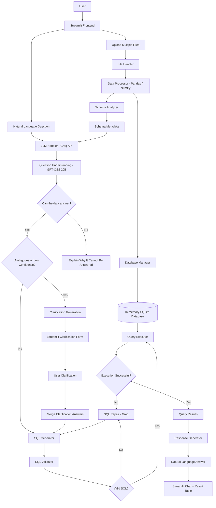
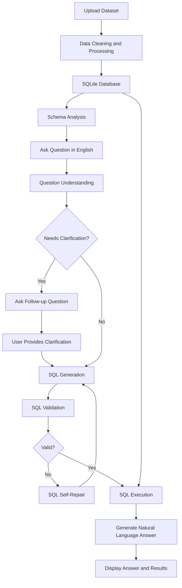

# 🧠Text-to-SQL with Intelligent Clarification Engine

An AI-powered Text-to-SQL application that allows users to interact with their datasets using natural language instead of writing SQL queries manually.

Users can upload structured datasets in CSV, Excel, TSV, TXT, and JSON formats, ask questions in plain English, and receive meaningful answers generated from their data.

The application uses **Groq API with OpenAI GPT-OSS 20B (`openai/gpt-oss-20b`)** for natural-language understanding, ambiguity detection, SQL generation, and response generation.

Unlike conventional Text-to-SQL systems, this project incorporates an **Intelligent Clarification Engine** that identifies ambiguous or incomplete questions and asks relevant follow-up questions before generating SQL queries. This helps minimize incorrect assumptions and improves the reliability of generated results.

## 🎯 Project Objectives

- Simplify data analysis for users without SQL knowledge.
- Convert natural-language questions into executable SQL queries.
- Understand dataset schemas and identify relevant columns.
- Detect ambiguous questions and resolve them through interactive clarification.
- Validate generated SQL queries before execution.
- Generate understandable answers from database query results.

## ✨ Key Features

**1. Multi-Format Dataset Upload**

- Supports CSV, TSV, TXT, Excel (`.xlsx`, `.xls`), and JSON files.
- Supports uploading multiple files.
- Handles Excel workbooks containing multiple sheets.

**2. Automated Data Processing**

- Cleans column names and converts them into SQL-friendly identifiers.
- Handles missing values and empty rows and columns.
- Identifies numeric and date-like values stored as text.
- Preserves identifier-like fields such as phone numbers, ZIP codes, and IDs.

**3. Automatic Schema Analysis**

- Extracts table names and column names.
- Identifies column data types.
- Analyzes unique values, missing values, and sample records.
- Extracts numerical ranges and categorical values.
- Provides schema context to the LLM.

**4. Intelligent Clarification Engine**

- Understands user intent using the uploaded dataset's schema.
- Identifies genuinely ambiguous questions.
- Evaluates the confidence of question interpretation.
- Generates relevant follow-up questions with multiple-choice options.
- Allows users to provide custom answers or skip clarification.
- Maintains recent conversation context for follow-up questions.

**5. AI-Powered SQL Generation**

- Converts natural-language questions into SQLite queries.
- Uses dataset schema and conversation history as context.
- Incorporates user clarifications and identified assumptions.
- Supports SQL self-repair when generated queries fail validation or execution.

**6. SQL Validation and Secure Execution**

- Allows only read-only SELECT and WITH queries.
- Blocks database modification operations.
- Checks SQL syntax and table/column references using SQLite EXPLAIN.
- Restricts execution time and maximum returned rows.
- Uses SQLite query-only mode as an additional database protection.

**7. Natural Language Response Generation**

- Converts SQL results into understandable answers.
- Formats numerical values for readability.
- Handles empty results and truncated outputs.
- Provides a fallback response if LLM-based response generation fails.

**8. Interactive Streamlit Interface**

- Chat-based question-and-answer interface.
- Dataset preview.
- Interactive clarification forms.
- Generated SQL inspection.
- Query result tables.
- Conversation history.

## 🏗️ System Architecture

The application follows a modular architecture with separate components for data ingestion, data processing, schema analysis, natural-language understanding, clarification, SQL generation, validation, execution, and response generation.

### Architecture Overview

1. **Data Ingestion:** Upload and read structured files.
2. **Data Processing:** Clean and transform uploaded datasets.
3. **Database Management:** Load processed DataFrames into an in-memory SQLite database.
4. **Schema Analysis:** Extract metadata and provide database context.
5. **Question Understanding:** Analyze user intent using GPT-OSS 20B through Groq.
6. **Clarification Engine:** Identify ambiguity and request additional information when necessary.
7. **SQL Generation:** Generate SQLite queries based on the question, schema, and clarification context.
8. **SQL Validation:** Validate queries and restrict unsafe operations.
9. **Query Execution:** Execute validated SQL against SQLite.
10. **Response Generation:** Convert query results into natural-language answers.

### Architecture Diagram



## 🔄 Application Pipeline



## 🧠 Intelligent Clarification Engine

The Clarification Engine is the core differentiating feature of this project.

Traditional Text-to-SQL systems may generate incorrect SQL when a user asks an ambiguous question. This project attempts to identify such ambiguity before generating the SQL query.

**Example:**

User question:

"Show me the top-performing employees."

Possible interpretations:

- Employees with the highest salaries.
- Employees with the highest sales.
- Employees with the highest performance scores.

Instead of making an arbitrary assumption, the application can ask:

"How would you like to rank the employees?"

- Highest salary
- Highest sales
- Highest performance score

Once the user responds, the clarification is incorporated into the SQL generation prompt.

### Clarification Workflow

- **Step 1:** Analyze the question against the available schema and recent conversation history.
- **Step 2:** Identify ambiguities and calculate an interpretation confidence score.
- **Step 3:** Compare confidence against the configured threshold (0.75).
- **Step 4:** Generate up to three clarification questions when necessary.
- **Step 5:** Collect user responses through interactive options or custom text.
- **Step 6:** Pass the original question and clarification context to the SQL generator.

If the question is already clear, the application skips clarification. If the uploaded data cannot answer the question, the application returns an explanation instead.

## 🔐 SQL Validation and Self-Repair

The project implements a read-only SQL validation mechanism to prevent unsafe database operations.

**Validation includes:**

- Restricting SQL to SELECT and WITH statements.
- Blocking INSERT, UPDATE, DELETE, DROP, ALTER, CREATE, and other prohibited operations.
- Preventing multiple SQL statements.
- Checking syntax and table/column references through SQLite EXPLAIN.
- Enforcing SQLite query-only mode.

If SQL generation, validation, or execution fails, the system attempts to regenerate a corrected query using the error information.

The application allows up to two repair attempts after the initial SQL generation.

## 🛠️ Technology Stack

| Category | Technologies |
|---|---|
| Programming Language | Python |
| Frontend | Streamlit |
| LLM Provider | Groq API |
| Language Model | OpenAI GPT-OSS 20B |
| Data Processing | Pandas, NumPy |
| Database | SQLite |
| File Handling | OpenPyXL, xlrd |
| Environment Management | python-dotenv |
| Testing | Pytest |

## 📂 Project Structure

```text
AI-Text-to-SQL/
│
├── app.py
├── requirements.txt
├── README.md
├── .env.example
├── pytest.ini
│
├── config/
│   └── settings.py
│
├── core/
│   ├── file_handler.py
│   ├── data_processor.py
│   ├── schema_analyzer.py
│   ├── llm_handler.py
│   ├── clarification_engine.py
│   ├── sql_generator.py
│   ├── sql_validator.py
│   ├── query_executor.py
│   └── response_generator.py
│
├── database/
│   └── database_manager.py
│
├── prompts/
│   ├── understanding_prompt.py
│   ├── clarification_prompt.py
│   ├── sql_prompt.py
│   └── response_prompt.py
│
├── utils/
│   └── helpers.py
│
├── sample_data/
│   └── employees.csv
│
├── tests/
│   ├── test_clarification.py
│   └── test_sql_generator.py
│
└── uploads/
```

## ⚙️ Installation and Setup

### 1. Clone the Repository

```bash
git clone https://github.com/YOUR_USERNAME/AI-Text-to-SQL.git
cd AI-Text-to-SQL
```

### 2. Create a Virtual Environment

```bash
python -m venv .venv
```

Activate the environment:

Windows:

```bash
.venv\Scripts\activate
```

Linux / macOS:

```bash
source .venv/bin/activate
```

### 3. Install Dependencies

```bash
pip install -r requirements.txt
```

### 4. Configure Environment Variables

Create a `.env` file in the project root.

```env
GROQ_API_KEY=your_groq_api_key
LLM_MODEL=openai/gpt-oss-20b
MAX_RESULT_ROWS=1000
```

Get your API key from the Groq Console: https://console.groq.com/keys

### 5. Run the Application

```bash
streamlit run app.py
```

## 💡 Example Queries

After uploading a dataset, users can ask:

| Natural Language Question | Expected Result |
|---|---|
| What is the average employee salary? | Average salary |
| How many employees are there? | Total employee count |
| Show the top 5 highest-paid employees. | Employee ranking |
| What is the average salary by department? | Department-wise aggregation |
| Which department has the highest number of employees? | Department comparison |
| Show employees hired after 2023. | Date-based filtering |

## 🧪 Testing

The project includes automated tests using Pytest.

Tests cover:

- Clarification detection and question generation.
- Confidence-based clarification decisions.
- Handling unanswerable questions.
- Clarification fallback behavior.
- SQL generation and SQL repair prompts.

Run the tests:

```bash
pytest
```

## ⚙️ Configuration

| Setting | Default |
|---|---|
| LLM Model | openai/gpt-oss-20b |
| Clarification Confidence Threshold | 0.75 |
| Maximum Clarification Questions | 3 |
| Maximum SQL Repair Attempts | 2 |
| Maximum Result Rows | 1000 |
| Query Execution Timeout | 10 seconds |
| Conversation History | 3 previous turns |
| Maximum Upload Size | 50 MB |

## 🚀 Future Enhancements

- Support for PostgreSQL and MySQL databases.
- Advanced conversational memory.
- Interactive charts and data visualization.
- Query performance optimization.
- Support for larger datasets.
- More advanced ambiguity detection.
- Export query results into CSV and Excel formats.

## 👨‍💻 Author

**Sahil Laskar**

Aspiring AI & Machine Learning Engineer

- GitHub: [SahilLASKAR13](https://github.com/SahilLASKAR13)
- LinkedIn: Add your LinkedIn profile

---

⭐ If you find this project useful, consider giving the repository a star!
